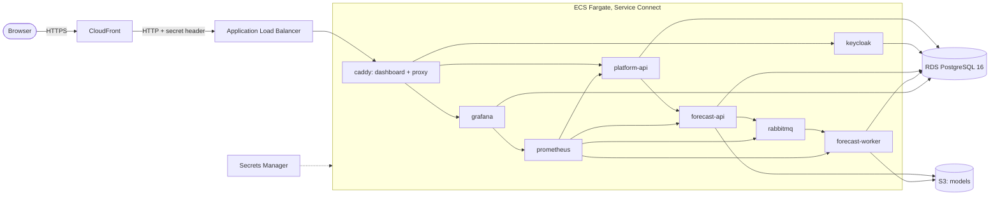

# AWS deployment

Runs the same containers as `compose.yaml` on AWS: ECS Fargate (ARM64) for the services, RDS for PostgreSQL, S3 for model files, and CloudFront for HTTPS. Everything is defined in Terraform, so one command creates it and one deletes it. The design decisions are in [ADR 0007](../../docs/adr/0007-aws-deployment.md).



| Local (compose) | AWS |
|---|---|
| `postgres`, `keycloak-db` | One RDS instance with the `supplychain` and `keycloak` databases |
| `caddy` with its own certificate | CloudFront HTTPS, then the load balancer, then `caddy` on port 80 |
| `data/` volume for models | S3 bucket (`STORE=s3`) |
| `.env` file | Secrets Manager, with passwords generated by Terraform |
| `flyway` container | One-off `migrate` task |
| `make generate && make load` | One-off `load-data` task |
| `scforecast train` | One-off `train` task |
| `etl-worker` | Not deployed: feeds are loaded by the one-off task |

## Prerequisites

- An AWS account and the AWS CLI signed in: `aws login` (or `aws sso login`), then `aws sts get-caller-identity` works.
- Terraform 1.6 or later: `brew install hashicorp/tap/terraform`.
- Docker running on Apple silicon (Docker Desktop or Colima). The images are built for `linux/arm64`.

## Deploy

```bash
cp infra/aws/terraform/terraform.tfvars.example infra/aws/terraform/terraform.tfvars
# edit: region, and alert_email for budget alerts

infra/aws/scripts/deploy.sh        # about 40 minutes; each terraform apply asks for "yes"
infra/aws/scripts/post-deploy.sh   # activates the model, runs a forecast and an optimization
```

`deploy.sh` runs these steps; any of them can also be run on its own:

1. `terraform apply -var services_enabled=false`: network, RDS, S3, ECR, secrets, load balancer and CloudFront. CloudFront takes 5 to 10 minutes.
2. `push-images.sh`: builds the 8 images and pushes them to ECR.
3. `run-task.sh db-init` and `run-task.sh migrate`: creates the Keycloak database and runs Flyway.
4. `terraform apply -var services_enabled=true`: starts one task per service.
5. `run-task.sh load-data` (about 15 minutes) and `run-task.sh train` (about 3 minutes).

The URL is `terraform -chdir=infra/aws/terraform output -raw public_url`. To get the demo users' password (`vic.viewer`, `pat.planner`, `max.manager`, `ada.admin`):

```bash
aws secretsmanager get-secret-value \
  --secret-id "$(terraform -chdir=infra/aws/terraform output -raw app_secret_arn)" \
  --query SecretString --output text | python3 -c 'import json,sys; print(json.load(sys.stdin)["DEMO_USER_PASSWORD"])'
```

Grafana is at `<url>/grafana/` as `admin` with `GRAFANA_ADMIN_PASSWORD` from the same secret.

## Update after a code change

```bash
infra/aws/scripts/push-images.sh platform-api caddy   # or no arguments for all images
aws ecs update-service --cluster supplychain-ai --service platform-api --force-new-deployment
```

## Cost and shutting down

Running, the stack costs roughly $8 to $10 a day (Fargate about $5, RDS about $1.60, load balancer about $0.60, public IPv4 addresses about $1). This is an estimate; the Billing console has the real numbers, and the budget alert emails you at 50, 80 and 100 percent of `monthly_budget_usd`.

| To | Run | Leaves running |
|---|---|---|
| Pause overnight | `terraform -chdir=infra/aws/terraform apply -var services_enabled=false` | RDS, load balancer, CloudFront (about $2.50 a day) |
| Resume | `terraform -chdir=infra/aws/terraform apply -var services_enabled=true` | |
| Delete everything | `infra/aws/scripts/destroy.sh` | Nothing; data, images and logs are deleted |

## Troubleshooting

| Problem | Check |
|---|---|
| A service keeps restarting | `aws logs tail /ecs/supplychain-ai --follow --log-stream-name-prefix <service>` |
| Need a shell in a container | `aws ecs execute-command --cluster supplychain-ai --task <task id> --container <service> --interactive --command sh` |
| 403 "Forbidden" from the load balancer | Requests must come through CloudFront; use the `public_url`. |
| Sign-in fails right after deploy | Keycloak takes 2 to 3 minutes to start and import the realm. |
| 504 from CloudFront | The request took over 60 seconds. The disruption evaluation (about 80 s) is too slow for CloudFront; show its last result instead. |

## Known limits

- The ETL worker isn't deployed. Feeds are loaded once by `load-data`; continuous ingestion would need the feeds in S3 or EFS.
- RabbitMQ runs as a single Fargate task without persistent storage, so queued jobs are lost if it restarts. It isn't Amazon MQ because Amazon MQ doesn't expose the Prometheus metrics the Grafana queue panels use.
- One task per service in one availability zone for RDS. That's for cost; production would use Multi-AZ and at least two tasks per service.
- Containers don't use read-only root filesystems on AWS yet (compose does).
- The Terraform state is local and contains the generated passwords. Don't commit it; for a team, move it to an S3 backend.
